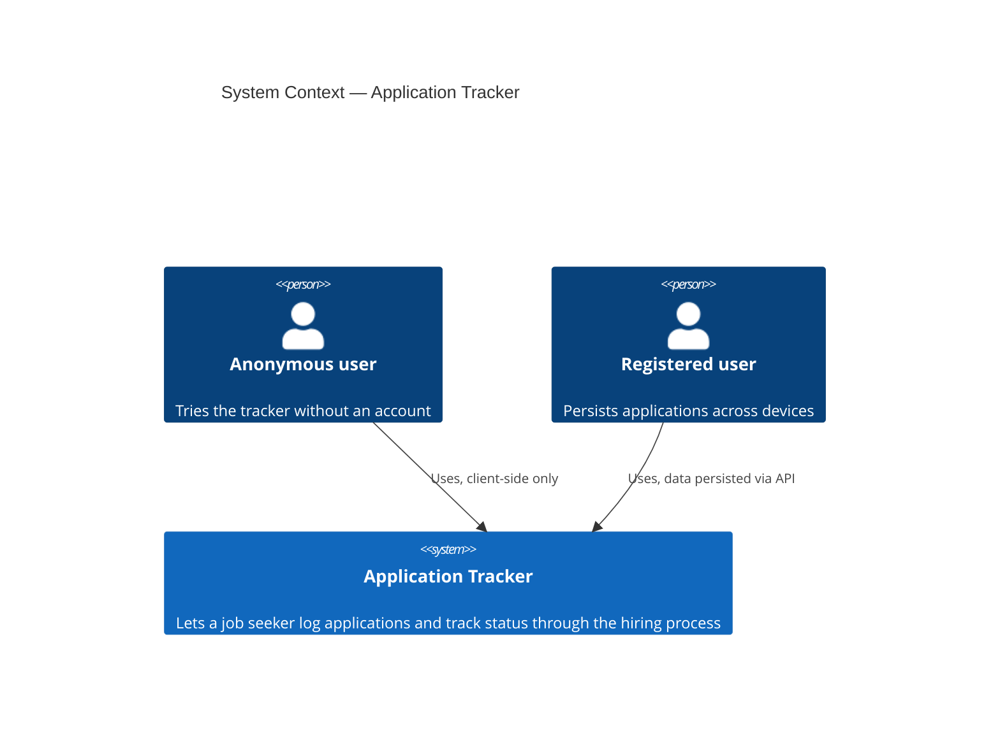
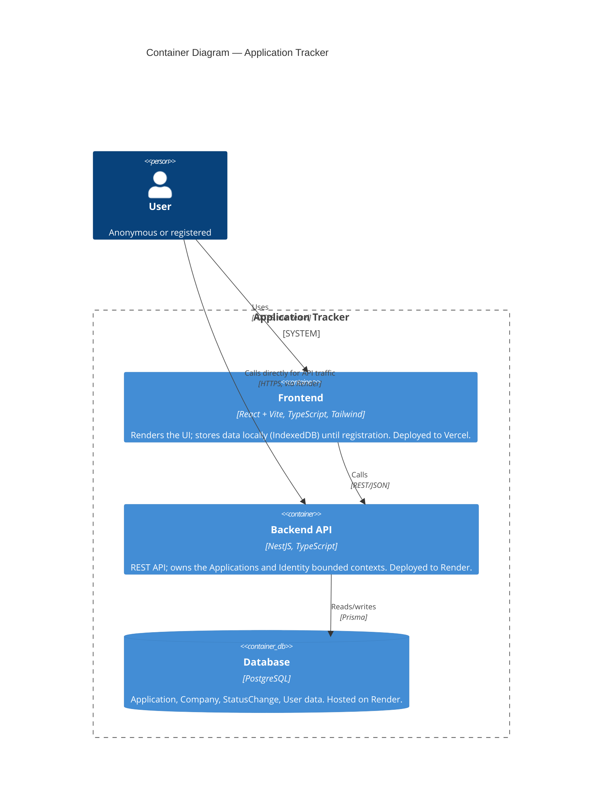
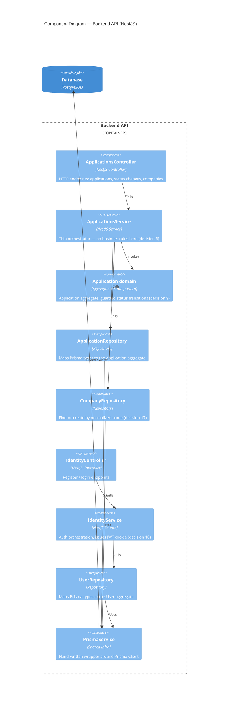
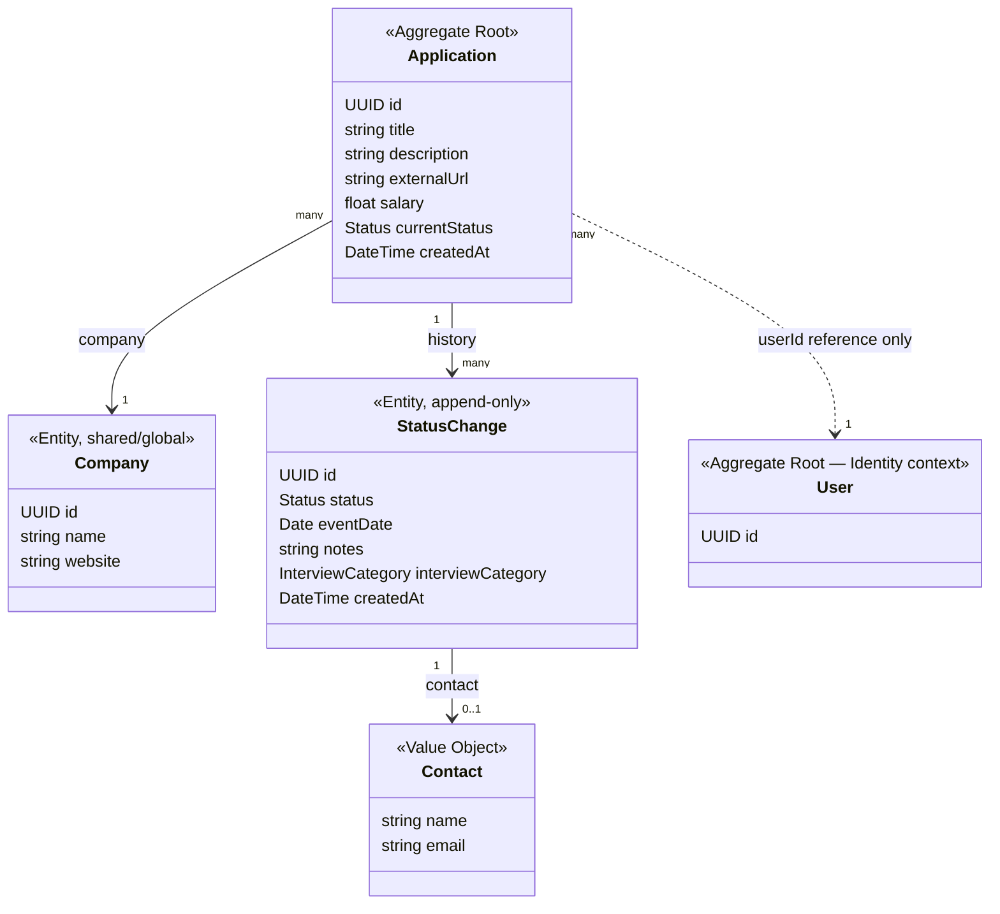
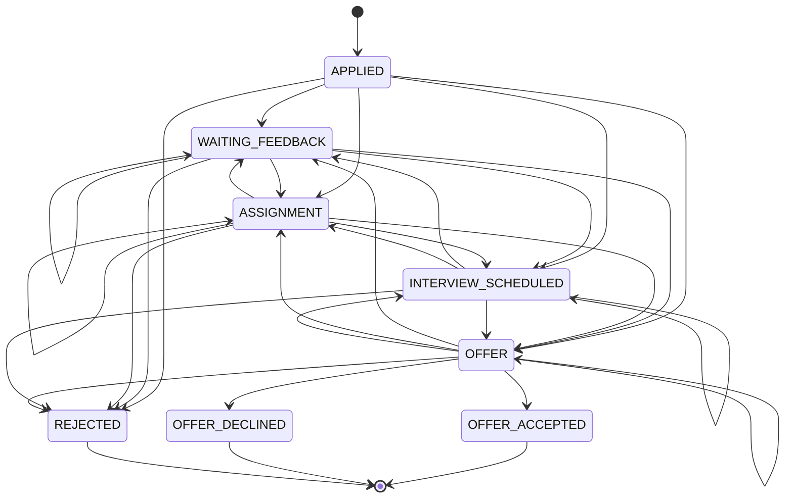

# Application Tracker — C4 Model & Domain Diagrams

Visual companion to `DECISIONS.md` — every box and arrow below traces back to a numbered decision there. This file doesn't introduce anything new; if a diagram and `DECISIONS.md` ever disagree, `DECISIONS.md` is the source of truth and this file is stale and needs updating.

C4 covers system architecture in three zoom levels (Context → Container → Component); it doesn't cover domain entities, so those get their own two diagrams at the end (entity relations, and the state machine).

---

## Level 1 — System Context

Who uses the system, and what the system is, at the highest zoom level.

No external systems appear here on purpose — the job posting link (`Application.externalUrl`) is a stored string, not an integration (decision 15).

---

## Level 2 — Container

The deployable units and how they talk to each other (decisions 1, 2, 4, 13, 22).

No reverse proxy container: an earlier design used nginx as a single entry point (`domain.com` / `api.domain.com`), but decision 22 replaced self-hosting with two managed platforms — Vercel and Render — that each terminate TLS/routing for their own service. One deployable service, not microservices (decision 1): `Backend API` is a single container even though it internally splits into two bounded contexts (see Component level below).

---

## Level 3 — Component (Backend API)

Zooming into the `Backend API` container (decisions 5, 6, 7, 9).

The `ApplicationsController`/`Service`/`Repository`/domain group and the `Identity*` group are the two bounded-context modules (`ApplicationsModule`, `IdentityModule`, decision 7) living inside the one container — `PrismaService` is the only thing both sides share.

---

## Domain model — entities & relations

The part C4 doesn't cover. Full field-level detail lives in `DECISIONS.md` #15–17; this is the shape, not the fields.

The dashed `Application ..> User` arrow is deliberate: it's a reference (a bare `userId`), not ownership — that's the Applications/Identity bounded-context boundary from decision 7. Every solid arrow is a real in-context relationship; `Contact` has no table of its own (it's columns on `StatusChange`, decision 16).

---

## State machine — status transitions

Direct visualization of decision 18's transition table.

It looks like a dense mesh in the middle on purpose — `WAITING_FEEDBACK`, `ASSIGNMENT`, `INTERVIEW_SCHEDULED`, and `OFFER` (including self-loops) all connect freely to each other, because real hiring processes don't move in a strict order. The only hard rules are: `APPLIED` is never re-entered, and once you hit `REJECTED`/`OFFER_ACCEPTED`/`OFFER_DECLINED` there's nowhere left to go.

---

*Regenerate or edit these alongside `DECISIONS.md` — if a decision changes, its diagram is wrong until updated.*
